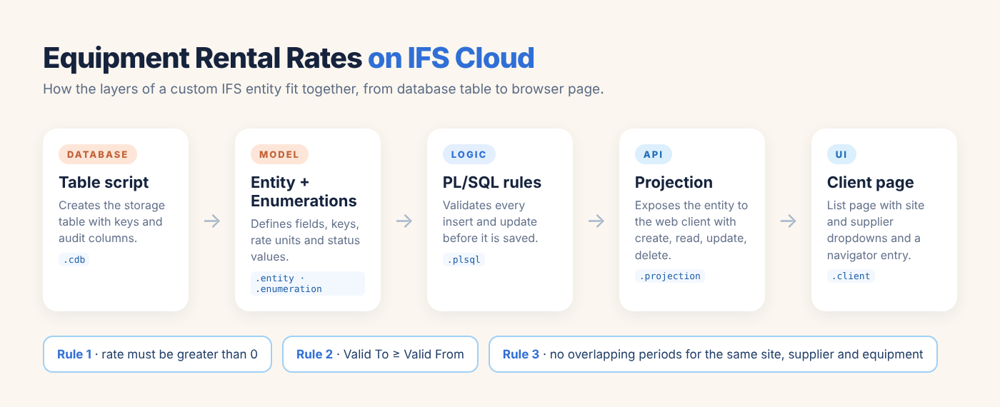

# IFS Cloud Custom Entity Example: Equipment Rental Rates

A complete, end-to-end example of building a **custom entity in IFS Cloud** with IFS Developer Studio: from the database table to a working page in the browser, including server-side validation rules.



## The business problem

A company rents equipment (forklifts, loaders, generators) from several suppliers across many sites. Each supplier charges a different rate per hour, day or week, and those rates change over time. Without one place to keep them:

- buyers look up rates in spreadsheets and e-mails
- the same rate gets entered twice for overlapping periods
- typos like a rate of 0 slip through

## The solution

A new **Equipment Rental Rates** page in IFS Cloud where each rate is stored once per site, supplier, equipment type and start date, with rules that stop bad data before it is saved.

| Field | Type | Notes |
|---|---|---|
| Site | Text (key) | Dropdown from IFS sites |
| Supplier | Text (key) | Dropdown from IFS suppliers |
| Equipment Type | Text (key) | Stored in upper case |
| Valid From | Date (key) | Start of the rate period |
| Valid To | Date | Optional end of the period |
| Rental Rate | Number | Must be greater than 0 |
| Rate Unit | Enumeration | Hour, Day, Week |
| Status | Enumeration | Active, Inactive |

### Validation rules (PL/SQL)

1. **Rate must be positive.** A rate of 0 or less is rejected.
2. **Dates must be in order.** Valid To cannot be earlier than Valid From.
3. **No overlapping periods.** The same site, supplier and equipment type cannot have two rates covering the same dates. A new rate for a later period is allowed.

## Project structure

```
model/mpccom/
  CRentalRateStatus-Cust.enumeration      Active / Inactive
  CRentalRateUom-Cust.enumeration         Hour / Day / Week
  CEquipmentRentalRate-Cust.entity        fields, keys, references
  CEquipmentRentalRateHandling-Cust.projection   API with full CRUD
  CEquipmentRentalRate-Cust.client        list page, dropdowns, navigator entry
source/mpccom/database/
  CEquipmentRentalRate-Cust.plsql         Check_Common___ validation rules
  11222026_CEquipmentRentalRate_MPCCOM.cdb   table creation script
docs/
  architecture.png
```

## How it is built and deployed

1. **Enumerations first.** Generate code for both enumerations so the entity can reference them.
2. **Table script.** Deploy the `.cdb` so the table exists before the entity is generated. Deploying the entity without the table fails with `ORA-00942`.
3. **Entity.** Generate and deploy the entity. IFS creates the API package, views and editioning view.
4. **Validation.** Add the `.plsql` source to the entity (right-click the entity, Add Source) and deploy packages only.
5. **Projection, then client.** Generate and deploy each file by right-clicking the file itself, not the folder.
6. **Permissions.** Grant the projection `CEquipmentRentalRateHandling` to the right permission set so users can open the page.
7. **Source control.** Commit only these files on a feature branch and open a pull request so the pipeline builds them.

## Lessons learned

- **Prefix custom objects** (here with `C`) so they never clash with existing names in the database.
- **The table must exist before the entity.** Keep the `.cdb` in source control, or the nightly build fails even when your local deploy worked.
- **Generate from the file, not the project.** Project-level generation can report "Target deploy does not exist".
- **Check every red ERROR line**, even when the output says "Code generation completed".

## Tech used

IFS Cloud 26R1 · IFS Developer Studio · Oracle PL/SQL · IFS Marble (entity, projection, client) · Git

## About this repository

This is a learning and portfolio example written from scratch to show how a custom IFS Cloud entity is designed and built. All names and data are fictional, and it contains no code, data or configuration from any employer or client. Syntax follows IFS Cloud 26R1 conventions; check it against your own version before using it.

Built by **Srikanth Mummadi**, IFS Cloud Technical Developer.
